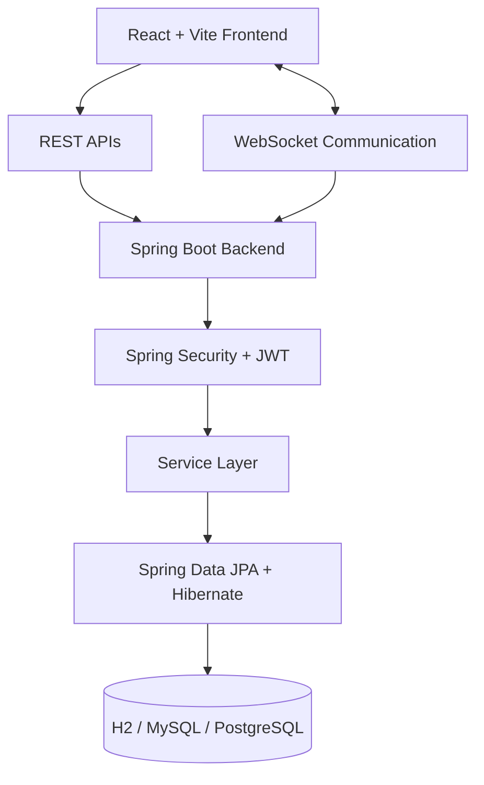

# 🚀 ProjectConnect
### A Social Collaboration Platform for Students & Developers

<p align="center">
  <strong>Connect. Collaborate. Build Together.</strong>
</p>

<p align="center">
  A full-stack platform for sharing technical knowledge, discovering projects, finding collaborators, and building software together.
</p>

---

## 📖 About the Project

**ProjectConnect** is a full-stack social collaboration platform designed specifically for students and developers. It brings technical networking, knowledge sharing, project discovery, and team collaboration into a single unified environment.

Unlike traditional social networking platforms, ProjectConnect focuses on helping users turn their technical skills and ideas into real-world projects. Users can share code snippets, publish technical discussions, discover collaborative opportunities, recruit teammates, and communicate through real-time messaging.

The platform combines a developer-focused social feed with project management workflows and skill-based matching to help users find the right people to build with.

### 🎯 Problem Statement

Students and developers often struggle to find suitable teammates, discover meaningful projects, showcase technical expertise, and communicate effectively within collaborative teams. General-purpose social platforms do not adequately support these technical collaboration needs.

**ProjectConnect addresses this gap** by providing a dedicated ecosystem for technical networking, project-based collaboration, and knowledge exchange.

---

## ✨ Key Features

### 🔐 1. Authentication & Security
- Secure user registration and login.
- JWT-based stateless authentication.
- Spring Security integration with role-based access control.
- BCrypt password hashing.
- Separate access roles for students, developers, and administrators.
- Demo accounts for quick evaluation.

### 👨‍💻 2. Developer Profiles
- Customizable profiles with biographies, education, and professional links.
- GitHub, LinkedIn, and portfolio integration.
- Skill and interest tags.
- Dedicated sections for posts, created projects, joined projects, followers, and following.

### 📰 3. Technical Social Feed
- Publish technical posts, tutorials, ideas, and engineering insights.
- Share code snippets with syntax highlighting.
- Organize content using technology tags such as `#Java`, `#React`, `#SpringBoot`, and `#SystemDesign`.
- Like posts and participate in discussions through comments.
- Explore all posts, followed users' posts, trending discussions, and tag-filtered content.
- Share posts through direct links.

### 🚀 4. Project Collaboration Hub
- Create and discover software development projects.
- Specify required skills, technology stacks, team size, and project descriptions.
- Add GitHub repositories and live demo links.
- Filter projects by recruitment status and technology.
- Apply to projects using personalized pitch messages.
- Allow project owners to review, accept, or reject applications.
- Update team membership following application decisions.

### 🧠 5. Smart Skill-Based Matching
- Calculate project compatibility based on overlapping skills.
- Recommend relevant projects according to user expertise.
- Evaluate collaborator synergy using shared skills, complementary technologies, and common interests.
- Help users discover potential teammates and suitable opportunities.

### 💬 6. Real-Time Messaging
- Private one-to-one conversations.
- Dedicated team conversations for collaborative projects.
- Unread message indicators.
- WebSocket communication using STOMP and SockJS.
- REST APIs for message retrieval and fallback workflows.

### 🔔 7. Live Notifications
- Notifications for likes, comments, and new followers.
- Alerts for project applications and application decisions.
- Messaging notifications and unread indicators.
- Mark individual or all notifications as read.

### 🔎 8. Unified Search
- Search for users and developer profiles.
- Discover projects by name, skills, and technology.
- Find technical posts and relevant discussions.
- Explore the platform through a unified search interface.

---

## 🛠️ Technology Stack

| Category | Technologies |
|---|---|
| Frontend | React 18, Vite |
| Styling & Icons | Tailwind CSS, Lucide React |
| Routing | React Router 6 |
| HTTP Communication | Axios, REST APIs |
| Real-Time Communication | WebSocket, STOMP, SockJS |
| Backend | Java, Spring Boot 3.3.4 |
| API Layer | Spring MVC |
| Security | Spring Security 6, JWT, BCrypt |
| Persistence | Spring Data JPA, Hibernate |
| Database | H2, MySQL / PostgreSQL support |
| Build Tool | Maven 3.9+ |
| JavaScript Runtime | Node.js, npm |

---

## 🏗️ System Architecture

ProjectConnect follows a layered full-stack architecture that separates the user interface, backend business logic, security, real-time communication, and database operations.



### Architecture Overview

- **Presentation Layer:** React provides the interactive user interface, with Vite powering the frontend development environment.
- **API Layer:** REST endpoints handle authentication, profiles, posts, projects, search, and other application operations.
- **Security Layer:** Spring Security and JWT protect authenticated operations and enforce access permissions.
- **Business Logic Layer:** Spring Boot services implement project workflows, application decisions, notifications, and skill-based matching.
- **Real-Time Layer:** WebSocket messaging enables live communication and event delivery.
- **Persistence Layer:** Spring Data JPA and Hibernate manage database operations.

---

## ⚙️ Getting Started

Follow these instructions to run ProjectConnect locally.

### Prerequisites

Install the following tools before starting:

- [Java JDK](https://adoptium.net/) — compatible with your configured project version.
- [Maven](https://maven.apache.org/download.cgi) — Maven 3.9+ recommended.
- [Node.js](https://nodejs.org/) — a version compatible with the frontend dependencies.
- [Git](https://git-scm.com/).

### 1. Clone the Repository

```bash
git clone https://github.com/YOUR_USERNAME/Collaboration-Student-Developer.git
cd Collaboration-Student-Developer
```

Replace `YOUR_USERNAME` with your GitHub username.

### 2. Start the Backend

Open a terminal in the repository root:

```bash
cd backend
mvn spring-boot:run
```

The backend is expected to run at:

```text
http://localhost:8080
```

### 3. Start the Frontend

Open a second terminal from the repository root:

```bash
cd frontend
npm install
npm run dev
```

The frontend is expected to be available at:

```text
http://localhost:5173
```

Open the displayed local URL in your browser.

### 4. Optional: One-Click Startup on Windows

If the repository includes the provided startup scripts, you can start both services using:

```powershell
.\start.ps1
```

Alternatively, double-click `start.bat` if it is present in the repository root.

> **Note:** Startup scripts, application ports, database settings, and seed-data behavior depend on the actual project configuration.

---

## 👥 Demo Accounts

The following demonstration accounts are intended for local evaluation when the corresponding seed data is enabled.

**Shared demo password:** `password123`

| Username | Role | Primary Skills |
|---|---|---|
| `tanveer` | Developer | Java, Spring Boot, React, Docker |
| `simerose` | Student | React, UI/UX, Tailwind CSS, Figma |
| `harleen` | Student | Spring Data JPA, PostgreSQL, SQL |
| `sarah_ai` | Developer | Python, PyTorch, LangChain, AI |
| `alex_dev` | Developer | TypeScript, Next.js, Kubernetes |

> **Security note:** These credentials are for local demonstrations only. Never use sample passwords in production or expose real credentials in a public repository.

---

## 📡 API Reference

The following table summarizes the principal REST endpoints.

### Authentication — `/api/auth`

| Method | Endpoint | Description |
|---|---|---|
| POST | `/api/auth/register` | Register a user |
| POST | `/api/auth/login` | Authenticate and receive a JWT |
| GET | `/api/auth/me` | Retrieve the authenticated user's profile |

### Posts & Social Feed — `/api/posts`

| Method | Endpoint | Description |
|---|---|---|
| GET | `/api/posts` | Retrieve posts |
| GET | `/api/posts/feed` | Retrieve followed users' posts |
| GET | `/api/posts/trending` | Retrieve trending discussions |
| GET | `/api/posts/tag/{tag}` | Filter posts by tag |
| POST | `/api/posts` | Create a technical post |
| POST | `/api/posts/{id}/like` | Toggle a post like |
| POST | `/api/posts/{id}/comments` | Add a comment |

### Projects — `/api/projects`

| Method | Endpoint | Description |
|---|---|---|
| GET | `/api/projects` | Browse available projects |
| POST | `/api/projects` | Create a project |
| GET | `/api/projects/{id}` | Retrieve project details |
| POST | `/api/projects/{id}/apply` | Apply to a project |
| GET | `/api/projects/{id}/applications` | Review project applications |
| POST | `/api/projects/applications/{id}/respond` | Respond to an application |

### Messaging & Notifications

| Method | Endpoint | Description |
|---|---|---|
| GET | `/api/messages/conversations` | Retrieve conversations |
| GET | `/api/messages/user/{userId}` | Retrieve a direct message thread |
| GET | `/api/messages/project/{projectId}` | Retrieve team messages |
| POST | `/api/messages` | Send a message |
| GET | `/api/notifications` | Retrieve notifications |
| PATCH | `/api/notifications/read-all` | Mark all notifications as read |

### Search & Recommendations

| Method | Endpoint | Description |
|---|---|---|
| GET | `/api/recommendations` | Retrieve personalized matches |
| GET | `/api/search?q={query}` | Search users, projects, and posts |

> API availability, request payloads, authentication requirements, and WebSocket destinations should be verified against the implemented backend controllers and security configuration.

---

## 🗄️ Database Configuration

ProjectConnect supports an embedded H2 database for local development, with MySQL and PostgreSQL support where configured.

### H2 Console

If enabled in the application configuration, access the console at:

```text
http://localhost:8080/h2-console
```

Example development connection settings:

| Setting | Value |
|---|---|
| JDBC URL | `jdbc:h2:mem:projectconnectdb` |
| Username | `sa` |
| Password | `password` |

The JDBC URL and credentials must match the application's actual configuration.

**Important:** An in-memory H2 database typically loses its data when the application stops. Use a configured persistent database when data retention is required.

For MySQL or PostgreSQL, configure the relevant JDBC URL, database credentials, and Spring profile or environment variables as required by the project.

---

## 🔒 Security Considerations

ProjectConnect incorporates several security mechanisms:

- JWT-based authentication for stateless API access.
- BCrypt password hashing.
- Role-based authorization for protected operations.
- Server-side authorization for project application decisions and team access.
- Authenticated messaging and user-specific resources.

For deployment, additional precautions are recommended:

- Store secrets and JWT signing keys in environment variables or a secrets manager.
- Never commit `.env` files or production credentials.
- Disable public H2 console access in production.
- Use HTTPS and secure CORS configuration.
- Validate user input and enforce authorization on every protected endpoint.
- Replace demo accounts and sample passwords before deployment.

---

## 🔮 Future Enhancements

Potential future improvements include:

- **AI-Powered Teammate Recommendations:** More advanced matching using project context, complementary skills, and user preferences.
- **GitHub Integration:** Import repositories, display contributions, and connect project activity to developer profiles.
- **Task Management:** Add task assignments, milestones, progress tracking, and project boards.
- **Video Collaboration:** Integrate real-time meetings and screen sharing.
- **Advanced Search:** Introduce ranking based on skill relevance, project activity, and user interests.
- **Portfolio Analytics:** Track contributions, project participation, and technical engagement.
- **Deployment & Scalability:** Add containerization, automated CI/CD, production database configuration, and monitoring.

---

## 🎓 Academic Project Information

| Detail | Information |
|---|---|
| Project Name | ProjectConnect |
| Course | Enterprise Web Application (UTA024) |
| Institution | Thapar Institute of Engineering & Technology, Patiala |
| Submitted To | Mr. Kashish Kausal |
| Batch | BE Third Year, 3C18 |
| Department | Computer Science & Engineering |

### 👨‍💻 Project Team

| Team Member | Roll Number |
|---|---|
| Tanveer Singh | 1024030244 |
| Simerose Kaur | 1024030248 |
| Harleen Singh | 1024030249 |

---

## 🤝 Contributing

Contributions, suggestions, and improvements are welcome.

1. Fork the repository.
2. Create a feature branch.
3. Implement and test your changes.
4. Commit your changes with a descriptive message.
5. Open a pull request describing your contribution.

```bash
git checkout -b feature/your-feature
git add .
git commit -m "Add your feature"
git push origin feature/your-feature
```

---

## 📄 License

No license has been specified yet. If you intend to distribute or reuse this project publicly, consider adding an appropriate `LICENSE` file.

---

## ⭐ Support the Project

If you find ProjectConnect useful, consider starring the repository and sharing feedback.

**ProjectConnect — Turning technical connections into real-world collaboration.**
